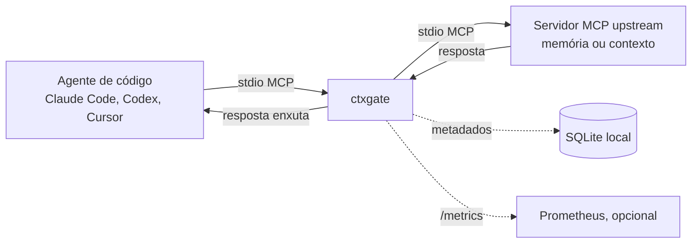

# ctxgate

> Proxy MCP local, escrito em Go, que corta contexto repetido ou irrelevante antes que ele chegue ao seu agente de código. Assim você gasta menos tokens e tem um prompt mais limpo, e consegue medir quanto economizou.

> ⚠️ **Status: em desenvolvimento (MVP).** Os comandos abaixo descrevem o comportamento planejado da v0.1.0. Os números de benchmark entram aqui quando a S5 estiver concluída.

## Por que usar

Agentes de código como Claude Code, Codex e Cursor recebem dos servidores MCP de memória e de contexto muito mais texto do que precisam, e boa parte dele se repete. Isso tem três consequências:

- **Custo:** você paga por tokens que não ajudam na tarefa.
- **Qualidade:** o prompt fica poluído, e o agente se distrai com trechos irrelevantes.
- **Visibilidade:** ninguém mede quanto contexto inútil está entrando.

O ctxgate fica entre o agente e esses servidores e resolve as três coisas localmente. Ele não usa LLM nem infraestrutura, e não manda nada para fora da sua máquina.

## Como funciona



O ctxgate é um proxy MCP local. O agente fala com ele por stdio, como falaria com qualquer servidor MCP, e ele repassa cada chamada ao servidor upstream configurado no YAML. Quando a resposta volta, ela passa por um pipeline antes de chegar ao agente:

1. **Dedup.** Remove os trechos repetidos dentro da mesma resposta: hash exato para cópias idênticas e simhash com Jaccard ≥0,90 para quase cópias.
2. **Ranking.** Ordena os trechos por relevância com BM25 local, sem LLM e sem rede. A consulta vem da config de cada tool ou, se não houver, dos argumentos da chamada. Sem consulta, nada é cortado.
3. **Orçamento.** Mantém os trechos mais relevantes até o limite de tokens configurado, contados com `cl100k_base`.
4. **Métricas.** Registra os tokens antes e depois e a latência, e grava os metadados no SQLite local.

## Garantias de projeto

- **Fail-open.** Se um estágio falhar, entrar em panic ou estourar o tempo, o agente recebe a resposta original intacta. O ctxgate nunca quebra uma chamada.
- **Conservador por padrão.** Conteúdo que não é texto e tipos desconhecidos passam sem mudança, e blocos de código nunca são partidos ao meio.
- **Rápido.** A meta é overhead p95 <20 ms nas respostas de até 100 KB.
- **Local e gratuito.** Não depende de nuvem nem de LLM. O SQLite usa um driver em Go puro, sem CGO, então o binário é um só.
- **Privado.** Por padrão grava só metadados. O conteúdo das respostas só é salvo no modo captura, que serve ao benchmark.

## Instalação

```bash
go install github.com/Viniciuscarvalho/ctxgate/cmd/ctxgate@v0.1.0
```

Você também pode baixar o binário em [GitHub Releases](https://github.com/Viniciuscarvalho/ctxgate/releases). Ele é estático (`CGO_ENABLED=0`) e sai para Linux, macOS e Windows.

## Configuração

`ctxgate.yaml`:

```yaml
version: 1

upstreams:
  - name: memory
    command: npx
    args: ["-y", "@modelcontextprotocol/server-memory"]

pipeline:
  budget_tokens: 6000

tools:
  search_nodes:
    query_args: ["query"]
```

> No MVP, a lista `upstreams` aceita exatamente 1 servidor. Campos desconhecidos geram erro com o nome do campo.

No seu agente, aponte o servidor MCP para o ctxgate em vez do upstream. Exemplo:

```json
{ "mcpServers": { "memory": { "command": "ctxgate", "args": ["serve", "--config", "ctxgate.yaml"] } } }
```

## Comandos

| Comando | O que faz |
|---|---|
| `ctxgate serve --config ctxgate.yaml` | Sobe o proxy via stdio e encerra quando o agente fecha o stdin |
| `ctxgate stats` _(em breve, S4)_ | Mostra os tokens economizados (absoluto e %) e a latência p50/p95 |
| `ctxgate bench keygen` _(em breve, S5)_ | Gera a chave HMAC do benchmark em `~/.ctxgate/bench-hmac.key` (0600) |
| `make bench-public` _(em breve, S5)_ | Roda o benchmark reproduzível no corpus sintético público |

Em breve (S4): endpoint Prometheus opcional, desligado por padrão.

## Benchmark

São duas camadas:

- **Público (reproduzível):** um corpus sintético em `bench/public/` com 10 formas de tarefa e seed fixa. Qualquer pessoa roda `make bench-public` e obtém os mesmos números.
- **Privado:** 10 tarefas reais de um projeto privado, rodadas em replay. No repositório ficam só os números agregados e o hash do corpus.

Metas: **≥30% menos tokens**, **10/10 tarefas com a evidência necessária preservada** e **overhead p95 <20ms** em respostas de até 100KB.

> **Limitação:** "sucesso" significa que o replay preservou as evidências que a tarefa exige. Isso é um proxy, e não a execução de um agente ao vivo. O replay assume que o agente faria as mesmas chamadas.

| Corpus | Tokens antes | Tokens depois | Economia | Sucesso | p95 |
|---|---|---|---|---|---|
| Público | _a medir_ | | | | |
| Privado | _a medir_ | | | | |

## Privacidade

Tudo roda localmente. Por padrão, o log em SQLite (`modernc.org/sqlite`, sem CGO) guarda só metadados. O conteúdo das respostas só é gravado no modo captura, que você precisa ligar explicitamente.

## Fora do escopo (por enquanto)

Sync entre máquinas, embeddings e LLM, UI web, multiusuário e transporte HTTP/SSE.

## Arquitetura e decisões

- `docs/PRD-ctxgate-mvp.md`: o problema, o escopo e as métricas.
- `docs/adr/`: as decisões de arquitetura (ADR-001 a ADR-006).
- Pacotes: `mcp/` (protocolo), `pipeline/` (estágios plugáveis), `store/` (SQLite) e `metrics/`.

## Licença

MIT
