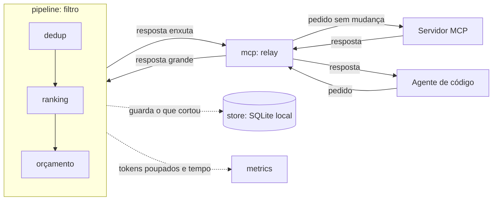

# Como o ctxgate funciona

O ctxgate fica entre o agente de código e o servidor MCP. Ele repassa as mensagens sem mexer nelas e só enxuga as respostas grandes das ferramentas antes que elas voltem ao agente.

## As peças

- **mcp** repassa as mensagens nos dois sentidos e não conhece as outras peças.
- **pipeline** corta, ranqueia e remove repetição. Se der erro, devolve a resposta original e o agente nunca quebra.
- **store** guarda num SQLite local o que foi cortado, para recuperar depois.
- **metrics** mostra quantos tokens foram poupados e quanto tempo isso custou.

## Como adicionar um estágio

1. Crie um tipo em `internal/pipeline` que implemente `Stage.Apply`.
2. Registre o tipo na lista de estágios do pipeline.
3. Escreva o teste do estágio sozinho.
4. Rode o benchmark e confira a economia e o p95.
5. Se mudar alguma interface, abra uma ADR antes.
