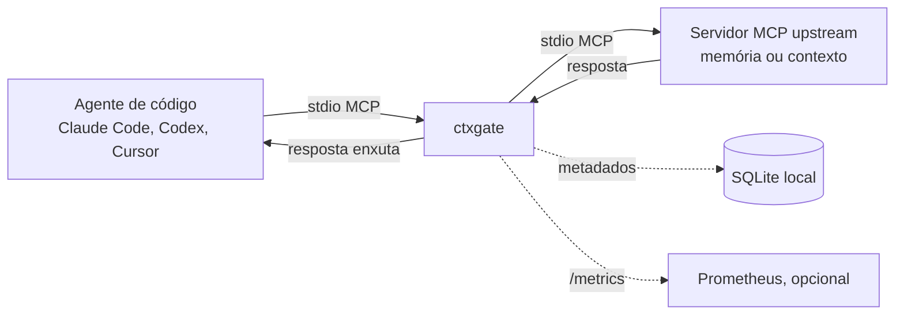

## Como funciona

O ctxgate é um proxy MCP local. O agente fala com ele por stdio, como falaria com qualquer servidor MCP, e ele repassa cada chamada ao servidor upstream configurado no YAML. Quando a resposta volta, ela passa por um pipeline antes de chegar ao agente:

1. **Dedup.** Remove os trechos repetidos dentro da mesma resposta: hash exato para cópias idênticas e simhash com Jaccard ≥0,90 para quase cópias.
2. **Ranking.** Ordena os trechos por relevância com BM25 local, sem LLM e sem rede. A consulta vem da config de cada tool ou, se não houver, dos argumentos da chamada. Sem consulta, nada é cortado.
3. **Orçamento.** Mantém os trechos mais relevantes até o limite de tokens configurado, contados com `cl100k_base`.
4. **Métricas.** Registra os tokens antes e depois e a latência, e grava os metadados no SQLite local.

## Garantias de projeto

- **Fail-open.** Se um estágio falhar, entrar em panic ou estourar o tempo, o agente recebe a resposta original intacta. O ctxgate nunca quebra uma chamada.
- **Conservador por padrão.** Conteúdo que não é texto e tipos desconhecidos passam sem mudança, e blocos de código nunca são partidos ao meio.
- **Rápido.** A meta é overhead p95 <20 ms nas respostas de até 100 KB.
- **Local e gratuito.** Não depende de nuvem nem de LLM. O SQLite usa um driver em Go puro, sem CGO, então o binário é um só.
- **Privado.** Por padrão grava só metadados. O conteúdo das respostas só é salvo no modo captura, que serve ao benchmark.

## Benchmark

O benchmark faz replay determinístico de 20 tarefas reais. Ele mede a redução de tokens e verifica se cada resposta manteve as evidências de que a tarefa precisa. Essa verificação é um proxy por replay, não uma taxa de sucesso medida com um agente ao vivo. Como o corpus original é de um produto privado, o repositório publica só os números agregados dele e inclui um corpus sintético que qualquer pessoa reproduz com `make bench-public`.
